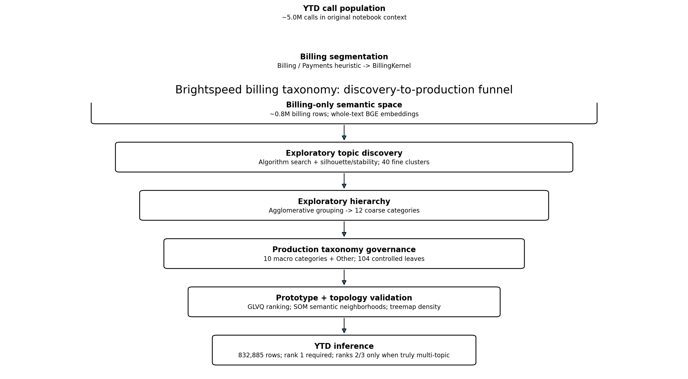
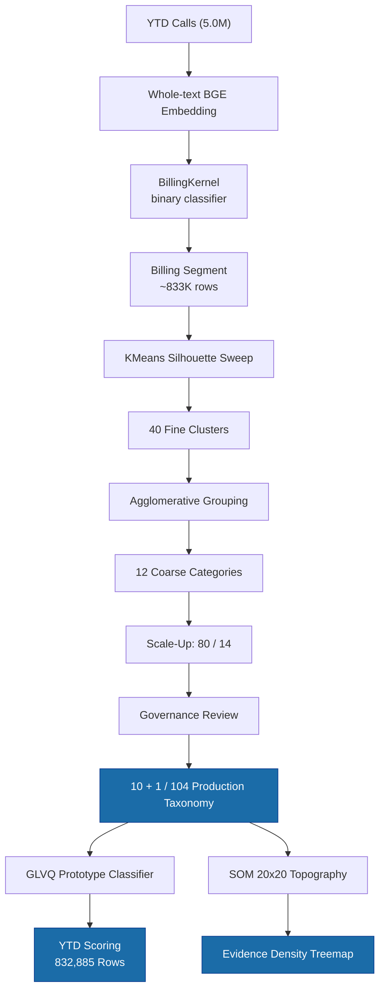
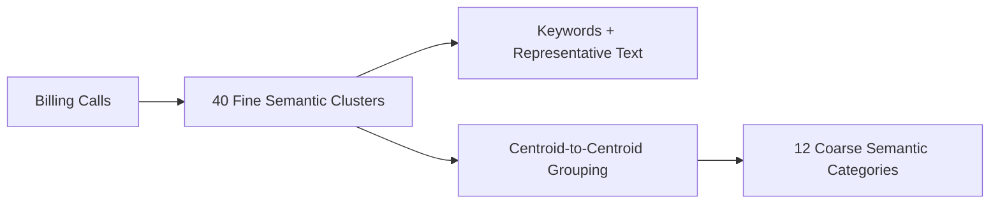
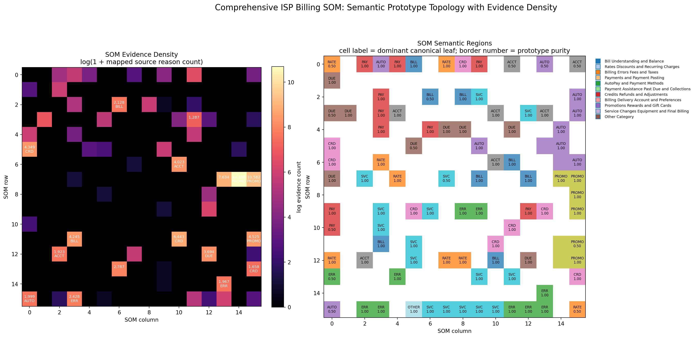
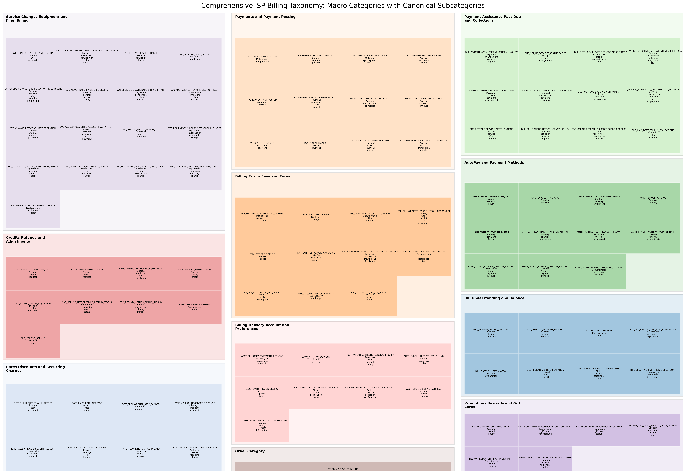
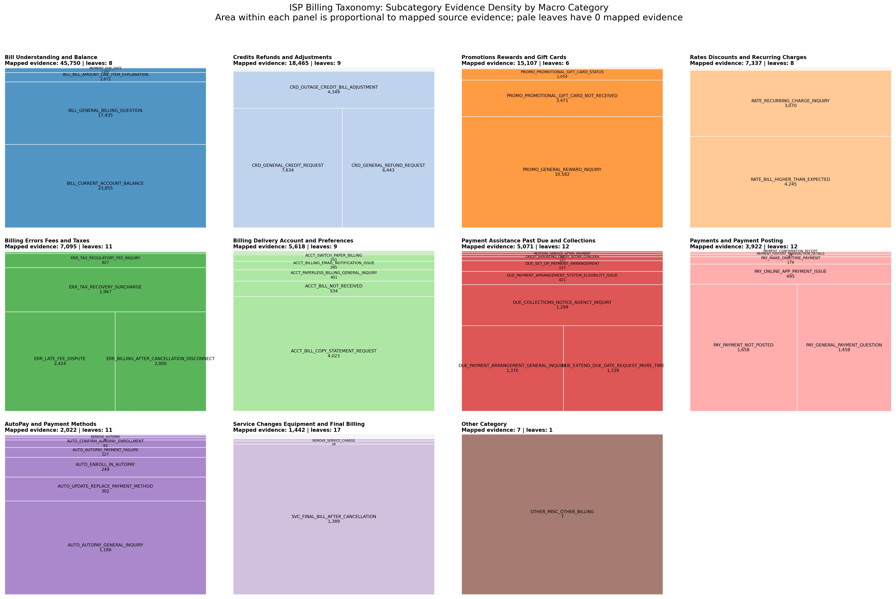
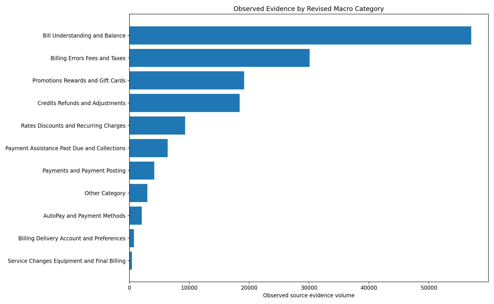
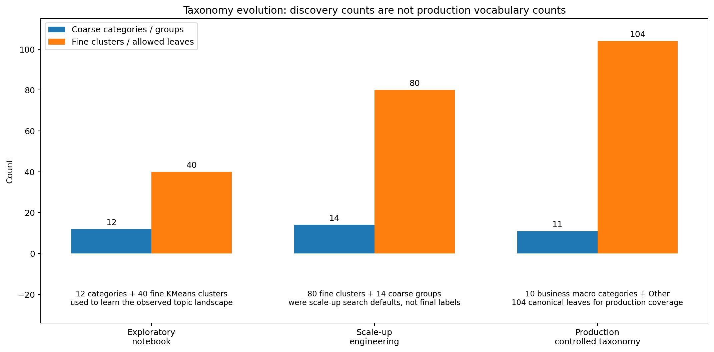
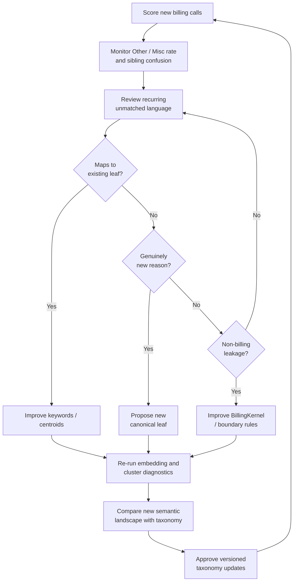

# Brightspeed Billing Taxonomy — Process Report

> From 5 million raw calls to a governed production taxonomy of 10 macro categories, 104 subcategories, and 832,885 classified billing rows.

---

## What this report covers

Brightspeed's billing taxonomy was built in stages — not handed down from a single clustering run. Each stage answers a different question, and the final output reflects business governance layered on top of data discovery.

| Stage | Structure | What it answers |
|---|---|---|
| Exploratory notebook | 12 categories / 40 fine clusters | What does the billing topic landscape actually look like? |
| Scale-up engineering build | 14 coarse groups / 80 fine clusters | What happens at higher discovery resolution? |
| **Production taxonomy** | **10 macro categories + Other / 104 canonical leaves** | **What stable vocabulary should classify all current and future billing contacts?** |



**12 / 40** was the data-discovery view. **10 + 1 / 104** is the governed production vocabulary. Silhouette and clustering help discover structure; they do not determine the final ontology alone.

---

## How the pipeline flows



---

## Input and output files

### Source data

| File | Location | Description |
|---|---|---|
| `billing_all_ytd.xlsx` | `input_output/` | Raw YTD billing call data — all rows before classification. Contains `call_intent`, `category`, `month`, and account fields. This is the **input** to the pipeline. |

### Pipeline outputs

| File | Location | Description |
|---|---|---|
| `billing_all_ytd_tagged.xlsx` | `input_output/` | Fully tagged output — every row with `ai_tag_1` / `ai_tag_2` / `ai_tag_3`, category, and subcategory. This is the **final deliverable**. |
| `billing_taxonomy_workbook.xlsx` | `artifacts/` | Review workbook with the canonical vocabulary, inference prompt, and non-technical usage notes |
| `brightspeed_excel_inference_output.xlsx` | `artifacts/` | Worked inference example showing tag assignment on sample rows |

### Model and taxonomy artifacts

| File | Location | Description |
|---|---|---|
| `canonical_vocabulary.csv` | `artifacts/` | Allowed tag vocabulary: tag, category, subcategory, definition |
| `tree_hierarchy.md` | `artifacts/` | Complete 104-leaf taxonomy tree with evidence provenance |
| `source_reason_to_canonical_mapping.csv` | `artifacts/` | Maps source reason texts to canonical tags (111,836 mapped rows) |
| `canonical_leaf_evidence_counts.csv` | `artifacts/` | Observed evidence count per leaf |
| `taxonomy_keywords.csv` | `artifacts/` | Per-leaf TF-IDF keyword sets |
| `curated_centroids_10_each.csv` | `artifacts/` | 10 curated representative texts per leaf |
| `billing_inference_prompt.txt` | `artifacts/` | Compact classification prompt for Excel-based tagging |

### Visual assets

| File | Location | Description |
|---|---|---|
| `process_funnel.png` | `assets/` | Discovery-to-production funnel diagram |
| `taxonomy_evolution.png` | `assets/` | Taxonomy stage evolution |
| `treemap_subcategories.png` | `assets/` | Subcategory call-volume treemap |
| `treemap_subcategory_evidence_density.png` | `assets/` | Evidence-density treemap overlay |
| `evidence_by_category.png` | `assets/` | Macro-category evidence rollup |
| `som_evidence_density.png` | `assets/` | SOM evidence-density topology |
| `som_map.png` | `assets/` | SOM 20×20 cell-level map |

### Notebook

| File | Location | Description |
|---|---|---|
| `01_billing_taxonomy_mining.ipynb` | root | End-to-end explanatory notebook: embedding → kernel → clustering → mining → GLVQ → SOM → scoring |

---

## 1. Embedding — one short intent, one vector

Every call's processed customer reason is treated as a single `call_intent` string and embedded whole — no sentence splitting, no chunking.

**Model:** `BAAI/bge-large-en-v1.5` · **Dimension:** 1024 · **Normalization:** L2 (cosine ≈ dot product)

```text
"payment made but not reflected on account"  →  1024-d unit vector
"charged after service was disconnected"      →  1024-d unit vector
"need more time to pay the bill"              →  1024-d unit vector
```

---

## 2. BillingKernel — narrowing the search space

The first learned kernel is a **binary billing classifier**. It prevents non-billing calls (service, repair, sales) from polluting the billing topic model.

**Architecture:**
- L2-regularized logistic regression on normalized BGE embeddings
- Isotonic calibration for probability scaling
- Decision threshold tuned on held-out 10% for max F1
- OneClassSVM stored as a secondary positive-class reference

The original notebook saw roughly **5 million** YTD calls. After kernel filtering, the working billing segment is **832,885 rows**.

---

## 3. Clustering — how many topics does the data support?

The notebook does not start by declaring 104 billing reasons. It first asks:

> *At what granularity do the billing embeddings form cohesive, separated groups?*

### Algorithm comparison

Five candidate methods are compared on four axes:

| Criterion | What it measures |
|---|---|
| **Silhouette** | Cohesion within clusters, separation between clusters |
| **Coverage** | No large share of calls left unassigned (HDBSCAN noise handled) |
| **Month stability** | Silhouette stays consistent across all 7 months |
| **Seed interpretability** | How naturally cluster centroids align with known billing concepts |

**Winner: KMeans** — full coverage, best silhouette, most stable across all months.

### Silhouette sweep

Candidate cluster counts are evaluated over a range, with silhouette measured on a manageable embedding subsample. The initial notebook settled on **40 fine clusters** as the discovery resolution — not a permanent subcategory count.

> 40 was a useful window into the observed semantic space. It does not mean Brightspeed can only have 40 billing subcategories.

---

## 4. Why 12 categories and 40 subcategories came first

Once 40 fine clusters existed, each was inspected for:

- Cluster volume
- Top TF-IDF keywords
- Representative text nearest centroid
- Semantic centroid vector

The 40 cluster centroids were then grouped into **12 coarse categories** using agglomerative clustering:



This was the first data-driven map of the billing topic space. It revealed major semantic neighborhoods, dominant volume drivers, confusing overlaps, and duplicate-looking clusters — but it did not yet define the permanent business vocabulary.

---

## 5. Scale-up: 80 fine clusters / 14 coarse groups

A later engineering build doubled the discovery resolution:

```text
K_CLUSTERS = 80    K_CATEGORIES = 14    MIN_LEAF = 250
```

The purpose was a **stress test**: expose splits, overlaps, and fragmentation that a coarser model hides. Clusters below the minimum leaf size were folded rather than promoted. This improved discovery stability but created a production risk — genuinely rare but valid customer reasons could disappear.

---

## 6. The governance step — data-informed, not data-imprisoned

This is where the taxonomy was redesigned. A production ontology has three distinct concepts:

| Status | Meaning |
|---|---|
| **Discovered** | Recurring evidence in the data forms a meaningful semantic topic |
| **Observed Rare** | Present in the data but too sparse for a robust unsupervised cluster |
| **Coverage Expansion** | A coherent Brightspeed billing reason with little or no observed evidence but that must remain classifiable |
| **Fallback** | Billing-related but no controlled leaf fits |

Example: **Vacation hold billing** appears at volume 2 in aggregate evidence. Pure clustering would remove it. The production taxonomy retains it because it is linguistically distinct and operationally plausible.

---

## 7. The final taxonomy: 10 + 1 / 104

The production vocabulary was deliberately reshaped around **few macro categories and many specific customer asks**.

### Category structure

| # | Category | Leaves |
|--:|---|--:|
| 1 | Bill Understanding and Balance | 8 |
| 2 | Rates Discounts and Recurring Charges | 8 |
| 3 | Billing Errors Fees and Taxes | 11 |
| 4 | Payments and Payment Posting | 12 |
| 5 | AutoPay and Payment Methods | 11 |
| 6 | Payment Assistance Past Due and Collections | 12 |
| 7 | Credits Refunds and Adjustments | 9 |
| 8 | Billing Delivery Account and Preferences | 9 |
| 9 | Promotions Rewards and Gift Cards | 6 |
| 10 | Service Changes Equipment and Final Billing | 17 |
| 11 | Other Category (fallback) | 1 |
| | **Total** | **104** |

### Why the subcategory count grew from 40 → 104

The 104 leaves combine:

```text
stable discovered intents
+ observed rare intents
+ deduplicated source reasons
+ explicit boundary splits
+ Brightspeed billing coverage expansions
+ one fallback
= controlled production vocabulary
```

Distinctions that deserve separate leaves even when clustering might merge them:

| Cluster might merge… | Production separates… |
|---|---|
| Bill clarification | Bill dispute |
| Late-fee dispute | Late-fee waiver |
| Payment failure | Payment made but not posted |
| AutoPay failure | Generic payment failure |
| Final bill inquiry | Continued billing after cancellation |
| Past-due balance | Service restoration after payment |
| Vacation hold request | Vacation hold billing impact |

The 104 leaves represent **business-semantic resolution**, not a claim that silhouette found 104 natural clusters.

---

## 8. Canonical tags

Each production leaf has a stable machine-facing tag:

```text
PAY_PAYMENT_NOT_POSTED
AUTO_AUTOPAY_PAYMENT_FAILURE
SVC_VACATION_HOLD_BILLING
ERR_INCORRECT_UNEXPECTED_CHARGE
OTHER_MISC_OTHER_BILLING
```

The canonical tag is the primary contract. Human-readable labels are obtained by lookup. The final taxonomy contains **104 canonical tags across 11 reporting categories**.

The mapped aggregate evidence file contains **111,836 source-reason observations** assigned to the final leaves. Coverage-only leaves can have zero historical evidence while remaining valid classifier outputs.

---

## 9. GLVQ — prototype learning after discovery

Generalized Learning Vector Quantization learns a discriminative prototype for each active subcategory over the normalized embedding space.

**Key distinction from KMeans:**

| | KMeans | GLVQ |
|---|---|---|
| Labels | None (unsupervised) | Cluster-to-taxonomy mapping |
| Goal | Discover geometric groups | Maximize inter-class separation |
| Output | Cluster assignments | Ranked prototypes with confidence |

**Training:** 90/10 split · prototypes initialized from seed embeddings · gradient descent with logistic phi function · renormalized to unit sphere after every step.

Held-out accuracy measures **pseudo-label reproducibility**, not human ground-truth accuracy. Production validation should additionally measure:

- Manually reviewed top-1 exact leaf agreement
- Top-k recall on multi-topic examples
- Per-leaf precision and recall
- Fallback rate
- Month-over-month drift

GLVQ top-k softmax values are ranking scores, not calibrated correctness probabilities.

---

## 10. SOM — semantic geography

The Self-Organizing Map projects billing embeddings onto a **20×20 Kohonen grid**. Each call lands in its Best-Matching Unit (BMU) cell; cells accumulate counts to form a topographic density surface.

**What a SOM answers that a taxonomy tree cannot:**

- Which billing topics occupy nearby semantic regions?
- Where are dense concentrations of calls?
- Which categories have fuzzy borders?
- Which leaves are isolated and distinctive?
- Where might two labels be redundant?

### SOM topology: evidence-density projection

Semantic prototype topology with mapped aggregate evidence projected onto cells. Cells are sized by evidence count and colored by dominant category.



### SOM cell analytics (generated at runtime)

The notebook produces a second SOM view: a **20×20 heatmap** where cell color = BMU-aggregated call count (magma colormap) and white text shows the top TF-IDF keywords and call count per occupied cell. A companion **3D topographic surface** renders the same grid with height proportional to call density. Both outputs are generated by the pipeline (`som_cells.png`, `som_3d.png`) and can be inspected in `outputs/` after a full run.

Each cell carries:

```text
cell(row, col) → call count · top keywords · dominant subcategory tag
```

For example (from the mapped evidence):

| Cell | Dominant tag | Category | Evidence count |
|---|---|---|---:|
| (0, 3) | `AUTO_CONFIRM_AUTOPAY_ENROLLMENT` | AutoPay and Payment Methods | 296 |
| (0, 11) | `ACCT_PAPERLESS_BILLING_GENERAL_INQUIRY` | Billing Delivery Account and Preferences | 678 |
| (2, 6) | `BILL_PAYMENT_DUE_DATE` | Bill Understanding and Balance | 2,128 |
| (2, 8) | `BILL_CURRENT_ACCOUNT_BALANCE` | Bill Understanding and Balance | 318 |
| (3, 1) | `DUE_COLLECTIONS_NOTICE_AGENCY_INQUIRY` | Payment Assistance Past Due and Collections | 941 |

> **Note:** The bundled SOM evidence-density image is a **semantic prototype topology with mapped aggregate evidence**, not a raw 832,885-call BMU density map. The original notebook's SOM update implementation differs from the conventional neighborhood update; the map is therefore a diagnostic visualization.

---

## 11. Treemap — evidence density in the production hierarchy

### Subcategory call-volume treemap

The full subcategory treemap shows every leaf sized by its call volume, colored by macro category. Each tile carries the leaf name and raw count. This is the canonical density view of the 104-leaf taxonomy.



### Subcategory evidence-density treemap

A second treemap overlays mapped aggregate source-reason evidence onto the same hierarchy. Observed high-volume reasons occupy more area. Low-volume or coverage-only leaves remain present even when their observed area is very small.



### Evidence by category

Macro-level rollup showing which categories absorb the most observed billing evidence.



This prevents two common errors:

1. **Removing valid rare reasons** because their current volume is low
2. **Visually inflating coverage-only labels** and pretending they were discovered at high volume

---

## 12. Inference contract

The production classifier does not force every call to have three topics.

```text
tag_1  =  mandatory
tag_2  =  optional (separate additional billing ask only)
tag_3  =  optional (separate additional billing ask only)
```

**Do not create extra tags for:**
- Synonyms or restatements
- Causes or consequences of the same problem
- Background account facts
- Alternate plausible interpretations

This is an entropy-reduction choice. Rank order communicates useful information without requiring pseudo-probability scores. The fallback `OTHER_MISC_OTHER_BILLING` is a valid primary tag when no specific leaf fits.

---

## 13. Population-level tagging results

| Metric | Count | Share |
|---|---:|---:|
| Billing rows tagged | **832,885** | 100.0% |
| Exactly 1 topic | **784,777** | 94.2% |
| Exactly 2 topics | **45,288** | 5.4% |
| 3 topics | **2,820** | 0.3% |
| At least a second topic | **48,108** | 5.8% |
| Using `OTHER_MISC_OTHER_BILLING` | **71,922** | 8.6% |

Low rank-2 and rank-3 rates are intentional — the system recognizes genuine multi-topic contacts without turning uncertainty into extra labels.

### Controlled-taxonomy summary

| Metric | Value |
|---|---:|
| Macro categories (including fallback) | 11 |
| Canonical subcategories | 104 |
| Curated centroid texts per leaf | 10 |
| Total curated centroid texts | 1,040 |
| Mapped aggregate source evidence | 111,836 |
| Final YTD rows scored | 832,885 |

---

## 14. Subcategories per macro category

| Category | Leaf count |
|---|---:|
| Bill Understanding and Balance | 8 |
| Rates Discounts and Recurring Charges | 8 |
| Billing Errors Fees and Taxes | 11 |
| Payments and Payment Posting | 12 |
| AutoPay and Payment Methods | 11 |
| Payment Assistance Past Due and Collections | 12 |
| Credits Refunds and Adjustments | 9 |
| Billing Delivery Account and Preferences | 9 |
| Promotions Rewards and Gift Cards | 6 |
| Service Changes Equipment and Final Billing | 17 |
| Other Category | 1 |
| **Total** | **104** |

---

## 15. Complete taxonomy tree

The full 104-leaf hierarchy with canonical tags, definitions, and evidence provenance:



**Bill Understanding and Balance** (8 leaves)

| Tag | Subcategory | Evidence |
|---|---|---|
| `BILL_GENERAL_BILLING_QUESTION` | General billing question | Observed |
| `BILL_CURRENT_ACCOUNT_BALANCE` | Current account balance | Observed |
| `BILL_PAYMENT_DUE_DATE` | Payment due date | Observed |
| `BILL_BILL_AMOUNT_LINE_ITEM_EXPLANATION` | Bill amount or line item explanation | Observed |
| `BILL_FIRST_BILL_EXPLANATION` | First bill explanation | Coverage Expansion |
| `BILL_PRORATED_BILL_EXPLANATION` | Prorated bill explanation | Coverage Expansion |
| `BILL_BILLING_CYCLE_STATEMENT_DATE` | Billing cycle or statement date | Coverage Expansion |
| `BILL_UPCOMING_ESTIMATED_BILL_AMOUNT` | Upcoming or estimated bill amount | Coverage Expansion |

**Rates Discounts and Recurring Charges** (8 leaves)

| Tag | Subcategory | Evidence |
|---|---|---|
| `RATE_BILL_HIGHER_THAN_EXPECTED` | Bill higher than expected | Observed |
| `RATE_PRICE_RATE_INCREASE` | Price or rate increase | Observed |
| `RATE_PROMOTIONAL_RATE_EXPIRED` | Promotional rate expired | Coverage Expansion |
| `RATE_MISSING_INCORRECT_DISCOUNT` | Missing or incorrect discount | Coverage Expansion |
| `RATE_LOWER_PRICE_DISCOUNT_REQUEST` | Lower price or discount request | Observed |
| `RATE_PLAN_PACKAGE_PRICE_INQUIRY` | Plan or package price inquiry | Observed |
| `RATE_RECURRING_CHARGE_INQUIRY` | Recurring charge inquiry | Observed |
| `RATE_ADD_FEATURE_RECURRING_CHARGE` | Add-on or feature recurring charge | Coverage Expansion |

**Billing Errors Fees and Taxes** (11 leaves)

| Tag | Subcategory | Evidence |
|---|---|---|
| `ERR_INCORRECT_UNEXPECTED_CHARGE` | Incorrect or unexpected charge | Observed |
| `ERR_DUPLICATE_CHARGE` | Duplicate charge | Coverage Expansion |
| `ERR_UNAUTHORIZED_BILLING_CHARGE` | Unauthorized billing charge | Coverage Expansion |
| `ERR_BILLING_AFTER_CANCELLATION_DISCONNECT` | Billing after cancellation or disconnect | Observed |
| `ERR_LATE_FEE_DISPUTE` | Late fee dispute | Observed |
| `ERR_LATE_FEE_WAIVER_AVOIDANCE` | Late fee waiver or avoidance | Observed |
| `ERR_RETURNED_PAYMENT_INSUFFICIENT_FUNDS_FEE` | Returned payment or insufficient funds fee | Coverage Expansion |
| `ERR_RECONNECTION_RESTORATION_FEE` | Reconnection or restoration fee | Coverage Expansion |
| `ERR_TAX_REGULATORY_FEE_INQUIRY` | Tax or regulatory fee inquiry | Observed |
| `ERR_TAX_RECOVERY_SURCHARGE` | Tax recovery surcharge | Observed |
| `ERR_INCORRECT_TAX_FEE_AMOUNT` | Incorrect tax or fee amount | Coverage Expansion |

**Payments and Payment Posting** (12 leaves)

| Tag | Subcategory | Evidence |
|---|---|---|
| `PAY_MAKE_ONE_TIME_PAYMENT` | Make a one-time payment | Observed |
| `PAY_GENERAL_PAYMENT_QUESTION` | General payment question | Observed |
| `PAY_ONLINE_APP_PAYMENT_ISSUE` | Online or app payment issue | Observed |
| `PAY_PAYMENT_DECLINED_FAILED` | Payment declined or failed | Coverage Expansion |
| `PAY_PAYMENT_NOT_POSTED` | Payment not posted | Observed |
| `PAY_PAYMENT_APPLIED_WRONG_ACCOUNT` | Payment applied to wrong account | Observed |
| `PAY_PAYMENT_CONFIRMATION_RECEIPT` | Payment confirmation or receipt | Observed |
| `PAY_PAYMENT_REVERSED_RETURNED` | Payment reversed or returned | Coverage Expansion |
| `PAY_DUPLICATE_PAYMENT` | Duplicate payment | Coverage Expansion |
| `PAY_PARTIAL_PAYMENT` | Partial payment | Coverage Expansion |
| `PAY_CHECK_MAILED_PAYMENT_STATUS` | Check or mailed payment status | Observed |
| `PAY_PAYMENT_HISTORY_TRANSACTION_DETAILS` | Payment history or transaction details | Observed |

**AutoPay and Payment Methods** (11 leaves)

| Tag | Subcategory | Evidence |
|---|---|---|
| `AUTO_AUTOPAY_GENERAL_INQUIRY` | AutoPay general inquiry | Observed |
| `AUTO_ENROLL_IN_AUTOPAY` | Enroll in AutoPay | Observed |
| `AUTO_CONFIRM_AUTOPAY_ENROLLMENT` | Confirm AutoPay enrollment | Observed |
| `AUTO_REMOVE_AUTOPAY` | Remove AutoPay | Observed |
| `AUTO_AUTOPAY_PAYMENT_FAILURE` | AutoPay payment failure | Observed |
| `AUTO_AUTOPAY_CHARGED_WRONG_AMOUNT` | AutoPay charged wrong amount | Coverage Expansion |
| `AUTO_DUPLICATE_AUTOPAY_WITHDRAWAL` | Duplicate AutoPay withdrawal | Coverage Expansion |
| `AUTO_CHANGE_AUTOPAY_PAYMENT_DATE` | Change AutoPay payment date | Coverage Expansion |
| `AUTO_UPDATE_REPLACE_PAYMENT_METHOD` | Update or replace payment method | Observed |
| `AUTO_UPDATE_AUTOPAY_PAYMENT_METHOD` | Update AutoPay payment method | Observed |
| `AUTO_COMPROMISED_CARD_BANK_ACCOUNT` | Compromised card or bank account | Observed |

**Payment Assistance Past Due and Collections** (12 leaves)

| Tag | Subcategory | Evidence |
|---|---|---|
| `DUE_PAYMENT_ARRANGEMENT_GENERAL_INQUIRY` | Payment arrangement general inquiry | Observed |
| `DUE_SET_UP_PAYMENT_ARRANGEMENT` | Set up payment arrangement | Observed |
| `DUE_EXTEND_DUE_DATE_REQUEST_MORE_TIME` | Extend due date or request more time | Observed |
| `DUE_PAYMENT_ARRANGEMENT_SYSTEM_ELIGIBILITY_ISSUE` | Payment arrangement system or eligibility issue | Observed |
| `DUE_MISSED_BROKEN_PAYMENT_ARRANGEMENT` | Missed or broken payment arrangement | Coverage Expansion |
| `DUE_FINANCIAL_HARDSHIP_PAYMENT_ASSISTANCE` | Financial hardship or payment assistance | Coverage Expansion |
| `DUE_PAST_DUE_BALANCE_NONPAYMENT` | Past due balance or nonpayment | Observed |
| `DUE_SERVICE_SUSPENDED_DISCONNECTED_NONPAYMENT` | Service suspended for nonpayment | Observed |
| `DUE_RESTORE_SERVICE_AFTER_PAYMENT` | Restore service after payment | Observed |
| `DUE_COLLECTIONS_NOTICE_AGENCY_INQUIRY` | Collections notice or agency inquiry | Observed |
| `DUE_CREDIT_REPORTING_CREDIT_SCORE_CONCERN` | Credit reporting or credit score concern | Observed |
| `DUE_PAID_DEBT_STILL_IN_COLLECTIONS` | Paid debt still in collections | Coverage Expansion |

**Credits Refunds and Adjustments** (9 leaves)

| Tag | Subcategory | Evidence |
|---|---|---|
| `CRD_GENERAL_CREDIT_REQUEST` | General credit request | Observed |
| `CRD_GENERAL_REFUND_REQUEST` | General refund request | Observed |
| `CRD_OUTAGE_CREDIT_BILL_ADJUSTMENT` | Outage credit or bill adjustment | Observed |
| `CRD_SERVICE_QUALITY_CREDIT` | Service quality credit | Coverage Expansion |
| `CRD_MISSING_CREDIT_ADJUSTMENT` | Missing credit or adjustment | Coverage Expansion |
| `CRD_REFUND_NOT_RECEIVED_REFUND_STATUS` | Refund not received or refund status | Observed |
| `CRD_REFUND_METHOD_TIMING_INQUIRY` | Refund method or timing inquiry | Coverage Expansion |
| `CRD_OVERPAYMENT_REFUND` | Overpayment refund | Coverage Expansion |
| `CRD_DEPOSIT_REFUND` | Deposit refund | Coverage Expansion |

**Billing Delivery Account and Preferences** (9 leaves)

| Tag | Subcategory | Evidence |
|---|---|---|
| `ACCT_BILL_COPY_STATEMENT_REQUEST` | Bill copy or statement request | Observed |
| `ACCT_BILL_NOT_RECEIVED` | Bill not received | Coverage Expansion |
| `ACCT_PAPERLESS_BILLING_GENERAL_INQUIRY` | Paperless billing general inquiry | Observed |
| `ACCT_ENROLL_IN_PAPERLESS_BILLING` | Enroll in paperless billing | Observed |
| `ACCT_SWITCH_PAPER_BILLING` | Switch to paper billing | Observed |
| `ACCT_BILLING_EMAIL_NOTIFICATION_ISSUE` | Billing email or notification issue | Coverage Expansion |
| `ACCT_ONLINE_ACCOUNT_ACCESS_VERIFICATION` | Online account access or verification | Observed |
| `ACCT_UPDATE_BILLING_ADDRESS` | Update billing address | Observed |
| `ACCT_UPDATE_BILLING_CONTACT_INFORMATION` | Update billing contact information | Coverage Expansion |

**Promotions Rewards and Gift Cards** (6 leaves)

| Tag | Subcategory | Evidence |
|---|---|---|
| `PROMO_GENERAL_REWARD_INQUIRY` | General reward inquiry | Observed |
| `PROMO_PROMOTIONAL_GIFT_CARD_NOT_RECEIVED` | Promotional gift card not received | Observed |
| `PROMO_PROMOTIONAL_GIFT_CARD_STATUS` | Promotional gift card status | Observed |
| `PROMO_GIFT_CARD_AMOUNT_VALUE_INQUIRY` | Gift card amount or value inquiry | Coverage Expansion |
| `PROMO_PROMOTION_REWARD_ELIGIBILITY` | Promotion or reward eligibility | Coverage Expansion |
| `PROMO_PROMOTION_TERMS_FULFILLMENT_TIMING` | Promotion terms or fulfillment timing | Coverage Expansion |

**Service Changes Equipment and Final Billing** (17 leaves)

| Tag | Subcategory | Evidence |
|---|---|---|
| `SVC_FINAL_BILL_AFTER_CANCELLATION` | Final bill after cancellation | Observed |
| `SVC_CANCEL_DISCONNECT_SERVICE_WITH_BILLING_IMPACT` | Cancel or disconnect with billing impact | Observed |
| `SVC_REMOVE_SERVICE_CHARGE` | Remove service or charge | Observed |
| `SVC_VACATION_HOLD_BILLING` | Vacation hold billing | Observed Rare |
| `SVC_RESUME_SERVICE_AFTER_VACATION_HOLD_BILLING` | Resume service after vacation hold | Coverage Expansion |
| `SVC_MOVE_TRANSFER_SERVICE_BILLING` | Move or transfer service billing | Coverage Expansion |
| `SVC_UPGRADE_DOWNGRADE_BILLING_IMPACT` | Upgrade or downgrade billing impact | Observed |
| `SVC_ADD_SERVICE_FEATURE_BILLING_IMPACT` | Add service or feature billing impact | Coverage Expansion |
| `SVC_CHANGE_EFFECTIVE_DATE_PRORATION` | Change effective date or proration | Coverage Expansion |
| `SVC_CLOSED_ACCOUNT_BALANCE_FINAL_PAYMENT` | Closed account balance or final payment | Coverage Expansion |
| `SVC_MODEM_ROUTER_RENTAL_FEE` | Modem or router rental fee | Observed |
| `SVC_EQUIPMENT_PURCHASE_OWNERSHIP_CHARGE` | Equipment purchase or ownership charge | Observed |
| `SVC_EQUIPMENT_RETURN_NONRETURN_CHARGE` | Equipment return or nonreturn charge | Coverage Expansion |
| `SVC_INSTALLATION_ACTIVATION_CHARGE` | Installation or activation charge | Coverage Expansion |
| `SVC_TECHNICIAN_VISIT_SERVICE_CALL_CHARGE` | Technician visit or service call charge | Coverage Expansion |
| `SVC_EQUIPMENT_SHIPPING_HANDLING_CHARGE` | Equipment shipping or handling charge | Coverage Expansion |
| `SVC_REPLACEMENT_EQUIPMENT_CHARGE` | Replacement equipment charge | Coverage Expansion |

**Other Category** (1 leaf)

| Tag | Subcategory | Evidence |
|---|---|---|
| `OTHER_MISC_OTHER_BILLING` | Misc or Other billing | Fallback |

---

## 16. Excel inference workflow

The taxonomy is deployed to stakeholders through an Excel-based workflow. The key artifacts:

| Artifact | File | Purpose |
|---|---|---|
| **Taxonomy workbook** | `billing_taxonomy_workbook.xlsx` | Review workbook containing the canonical vocabulary, prompt, and non-technical usage notes |
| **Inference prompt** | `billing_inference_prompt.txt` | Compact classification prompt for LLM-based or manual tagging |
| **ChatGPT Plugin prompt** | `ChatGPT_Prompt.md` | Full controlled-vocabulary prompt for business users self-serving via the ChatGPT Excel plugin. Contains anti-drift rules, the complete 104-tag vocabulary table, and usage instructions |
| **Example output** | `brightspeed_excel_inference_output.xlsx` | Worked inference output showing tag assignment on sample rows |
| **Canonical vocabulary** | `canonical_vocabulary.csv` | Allowed tag vocabulary with exact readable labels |

### Classification prompt

The prompt used for Excel-based classification (`billing_inference_prompt.txt`):

```text
BRIGHTSPEED BILLING CALL CLASSIFICATION

Classify each call using only the call_intent text and the Canonical_Vocabulary sheet.

RULES
1. tag_1 is required. Choose the single most specific supported canonical_tag.
2. Use tag_2 or tag_3 only when the call clearly contains a separate
   additional billing ask. Leave unused ranks blank.
3. Do not add extra tags for synonyms, background facts, causes,
   symptoms, or consequences of the same issue.
4. Rank distinct topics by the customer's main ask, then secondary asks.
5. Use only canonical_tag values from Canonical_Vocabulary.
   Never invent or alter a tag.
6. If no specific tag fits, use OTHER_MISC_OTHER_BILLING.
7. Copy category and subcategory exactly from Canonical_Vocabulary
   for each selected tag.

WRITE THESE COLUMNS
ai_tag_1, ai_category_1, ai_subcategory_1
ai_tag_2, ai_category_2, ai_subcategory_2
ai_tag_3, ai_category_3, ai_subcategory_3

Leave rank 2 and rank 3 fields blank unless the call truly has
multiple distinct billing topics.
```

---

## 18. Recommended governance loop



High-volume structural changes should be supported by data. Rare but legitimate customer reasons should not disappear because a clustering threshold cannot discover them in the current period.

---

## 19. What the process proves — and what it does not

### Supported conclusions

Brightspeed billing contacts contain a stable core of recurring semantic themes around bill understanding, pricing, errors, payments, AutoPay, payment assistance, credits, billing preferences, promotions, and service-lifecycle billing consequences.

The discovery workflow provides empirical evidence for those neighborhoods. The final taxonomy expands that evidence into a governed production vocabulary.

### Honest limitations

| Claim | Reality |
|---|---|
| 104 silhouette-validated natural clusters | **No.** 104 business-semantic leaves — not all silhouette-optimal |
| 10 mathematically optimal macro categories | **No.** 10 reporting categories chosen for operational usefulness |
| GLVQ accuracy = ground truth | **No.** Held-out accuracy measures pseudo-label reproducibility only |
| GLVQ scores = calibrated probabilities | **No.** Top-k scores are ranking scores, not correctness probabilities |
| SOM = raw 832K-call BMU map | **No.** Evidence-density prototype topology with mapped aggregate evidence |

These distinctions are strengths, not weaknesses. They keep discovery, modeling, governance, and production classification appropriately separated.

---

## Bottom line

The **12-category / 40-cluster** result was the right starting point — it revealed the semantic skeleton. The **10 macro categories + Other / 104 canonical leaves** is the right production output — it adds governance, billing boundaries, rare-intent retention, canonical machine tags, and a fallback.

The notebook, algorithm search, silhouette analysis, GLVQ, SOM, treemap, controlled taxonomy, and YTD inference are not competing approaches. They are sequential layers of one process:

> **Discover the landscape → test the geometry → govern the vocabulary → validate the boundaries → visualize the evidence → classify at scale.**

---

## Appendix — artifact inventory

All production artifacts live in `artifacts/`. Visual assets for this report live in `assets/`.

### Taxonomy and vocabulary

| File | Description |
|---|---|
| `taxonomy.json` | Full seeded taxonomy hierarchy (categories → subcategories → keywords) |
| `canonical_vocabulary.csv` | Allowed tag vocabulary: canonical tag, category, subcategory, definition, keywords |
| `tree_hierarchy.md` | Complete 104-leaf taxonomy tree with definitions and evidence provenance |
| `taxonomy_keywords.csv` | Per-leaf TF-IDF keyword sets |
| `curated_centroids_10_each.csv` | 10 curated representative texts per leaf (1,040 total) |

### Evidence and mapping

| File | Description |
|---|---|
| `source_reason_to_canonical_mapping.csv` | Maps every source reason text to its canonical leaf tag |
| `canonical_leaf_evidence_counts.csv` | Observed evidence count per canonical leaf (111,836 mapped rows) |
| `som_cells_evidence_density.csv` | SOM cell-level data: cell coords, dominant tag, evidence count, purity |
| `som_legend.csv` | SOM cell → subcategory mapping (20×20 grid legend) |

### Visualizations

| File | Description |
|---|---|
| `treemap.png` | Call-volume treemap by Category → Subcategory |
| `treemap_subcategories.png` | Subcategory treemap with leaf-level call counts |
| `treemap_subcategory_evidence_density.png` | Evidence-density treemap overlay |
| `evidence_by_category.png` | Macro-category evidence rollup |
| `som_evidence_density.png` | SOM evidence-density topology (report visual) |
| `som_map.png` | SOM 20×20 cell-level map with keywords |

### Excel workflow

| File | Description |
|---|---|
| `billing_taxonomy_workbook.xlsx` | Review workbook with taxonomy, prompt, and usage notes |
| `billing_inference_prompt.txt` | Compact classification prompt for Excel-based tagging |
| `ChatGPT_Prompt.md` | Full controlled-vocabulary prompt for ChatGPT Excel plugin with anti-drift rules |
| `brightspeed_excel_inference_output.xlsx` | Worked inference output example |

### Model artifacts (generated by pipeline)

| File | Description |
|---|---|
| `billing_kernel.joblib` | Trained BillingKernel binary classifier |
| `glvq.joblib` | Trained GLVQ prototype model |
| `glvq_active_keys.json` | Active subcategory keys for GLVQ scoring |
| `som20.joblib` / `som.joblib` | Trained 20×20 Kohonen SOM |
| `subcat_seed_protos.npy` | Embedded subcategory seed prototypes |
| `subcat_artifacts.json` | Subcategory artifact metadata |
